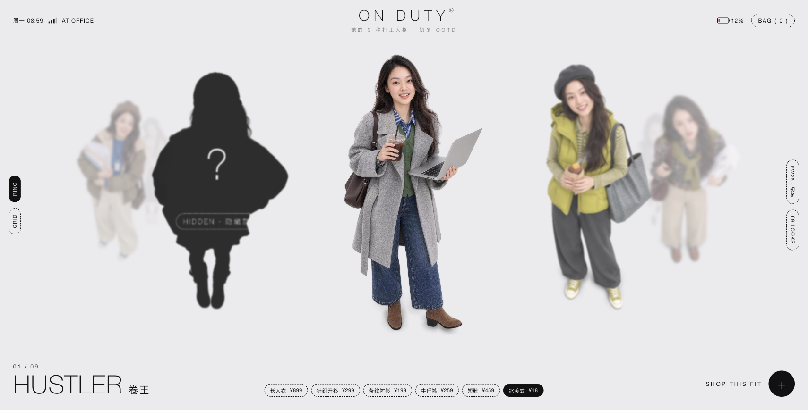

# 环形互动网站生成器 · ring-showcase

将人物、穿搭、商品或作品素材做成可以拖拽浏览的互动展示网站。基于 ON DUTY 高清放大镜版本，复用现有交互，替换图片与配置即可制作新的系列。

## 网页主页预览



原版示例：同一个女生的 9 种打工人格，支持环形拖拽浏览、隐藏款解锁，以及点击进入单品详情。

## 效果

- 环形拖拽、滚轮/方向键切换、松手吸附和呼吸漂浮。
- 环形与网格位置过渡、热点标签和小票式详情。
- 隐藏款剪影、抖动、白光与独立解锁。
- 可选高清放大镜，滚轮调整 1.5–4 倍。
- 模拟加购、自动光标演示、3:4 竖屏切换。

## 获取 Skill

[下载完整 Skill ZIP](https://github.com/guoyafen/ring-showcase/releases/latest/download/ring-showcase-skill.zip)

ZIP 内的 `ring-showcase/` 包含 SKILL.md、模板、生成脚本、配置说明和原版示例图片。将整个文件夹交给支持本地 Skill 的 AI 工具安装，不要只复制 SKILL.md。

也可以直接获取本仓库源码；仓库根目录即技能目录。

安装后向 AI 提出：

> 使用 ring-showcase，把这个文件夹里的素材做成环形互动网站。品牌改为「我的品牌」，第 9 张设为隐藏款，没有提供价格的标为非卖品。生成到新目录，并在浏览器里验收。

## 直接生成网站

生成器仅依赖 Python 3 标准库；查看网站需要现代浏览器，无需 API Key、npm 或外部 CDN。

在本仓库目录运行原版示例：

```bash
python3 scripts/create_showcase.py --example ootd --output ./my-showcase
```

自定义素材：复制 `assets/config.example.json`，按 [配置说明](references/config.md) 填入图片路径、名称、介绍、可选价格和热区。图片路径相对于 JSON 文件解析。

```bash
python3 scripts/create_showcase.py --config /path/to/config.json --output ./new-showcase
```

输出目录必须尚不存在，以免覆盖文件。生成的网站为独立静态目录，包含全部图片。可直接打开 index.html，也可以用本地 HTTP 服务：

```bash
python3 -m http.server 8000 --bind 127.0.0.1 --directory ./my-showcase
```

访问 `http://127.0.0.1:8000/`。运行时加载 config.js；修改 config.json 后需要重新生成到新目录，或直接编辑生成结果中的 config.js。

## 素材要求与边界

- 支持 1–12 项；9 张 2:3 竖图、3 列网格最接近原版。其他数量、比例和长文案需要检查实际布局。
- 推荐透明 PNG，统一画布比例、主体尺度与位置；不透明照片需先处理背景。此技能不提供生图或自动抠图。
- 换图后需重新校准热区。高清图与展示图需保持同一比例、构图和主体位置，否则放大镜会错位。
- 高清图为可选；缺少时该项关闭放大镜。新素材不要沿用示例轮廓遮罩。
- 加购为当前页面的演示计数，刷新清空；不包含真实订单、支付、库存、登录或托管部署。
- 使用者应提供有权使用的素材。

## 快捷键

D 自动演示；V 竖屏；G 环形/网格；H 光标开关；Esc 停止演示或关闭详情；左右箭头切换；Enter 打开详情。

## 验证范围

已用原版 9 人素材及另一套 4 件素材验证换图、品牌与配色配置、详情、高清放大镜、加购、独立隐藏款和自动演示。另验证 1 项无隐藏款演示、12 项网格、拖拽吸附、拒绝无效热区及已有输出目录。不同环境与新素材仍需进行浏览器验收。

## 开源许可

本项目采用 [MIT License](LICENSE)，版权声明为 Copyright (c) 2026 guoyafen。

允许免费使用、修改、商业使用及再分发（包括收费分发），需保留版权和许可声明；按许可证原文提供，不作担保。Skill 下载包和生成的网站均附带 LICENSE。

MIT 许可适用于本项目由发布者有权授权的内容，不替代第三方素材自身的授权，也不授予第三方商标或肖像权。使用者新增或替换素材时，应自行取得所需授权。
